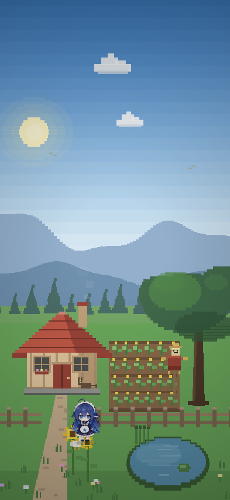
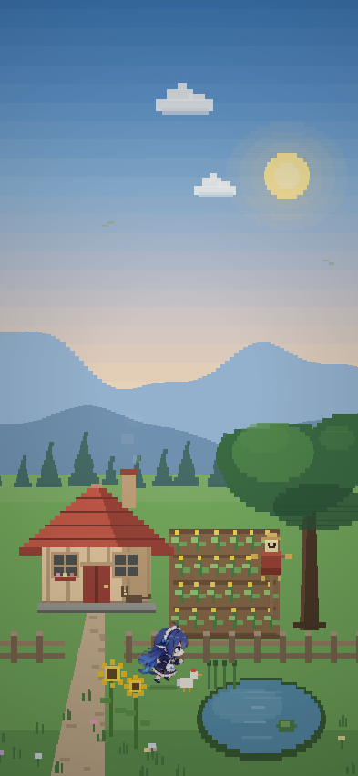
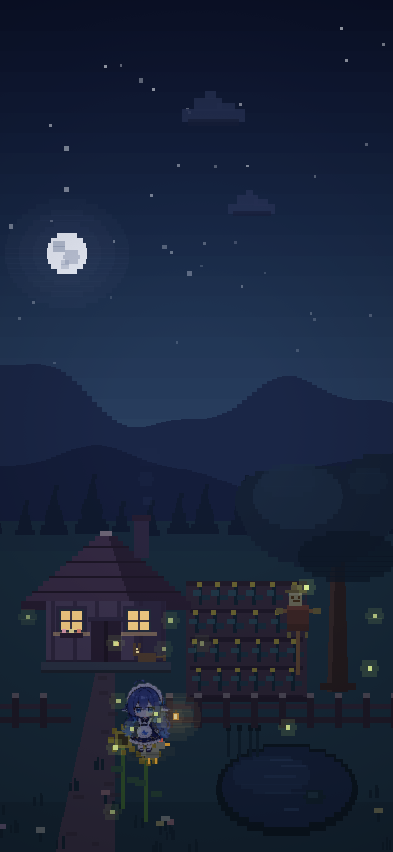
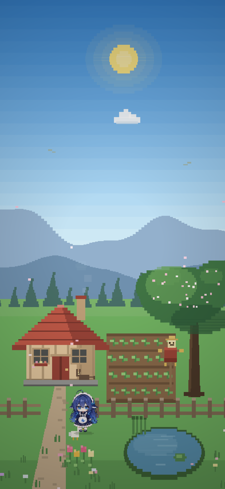
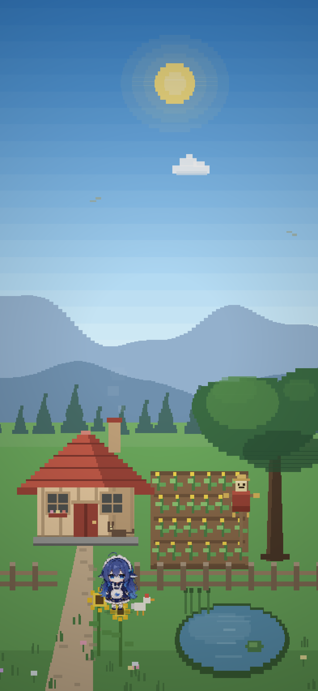
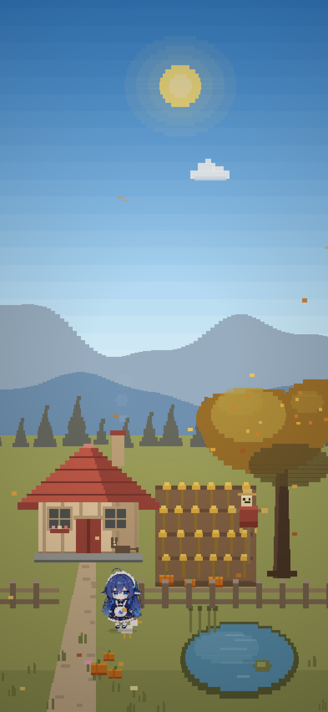
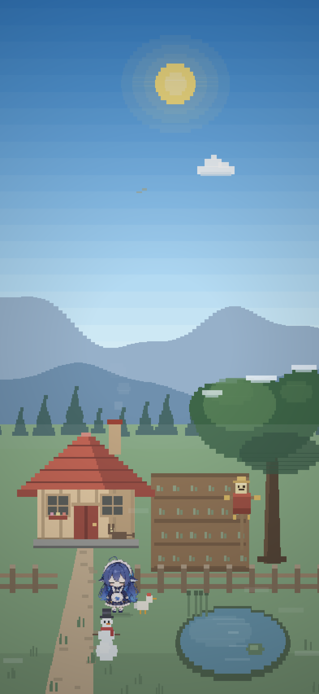
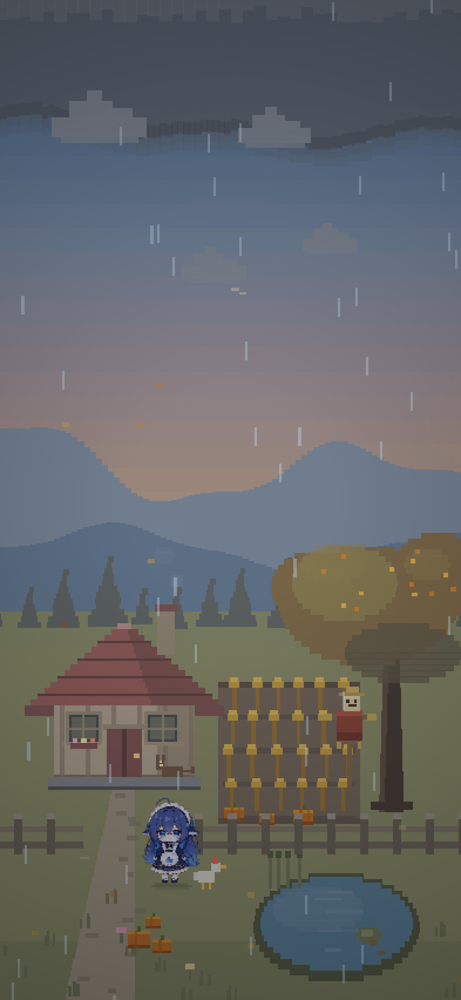
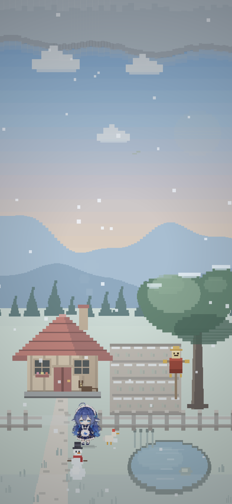
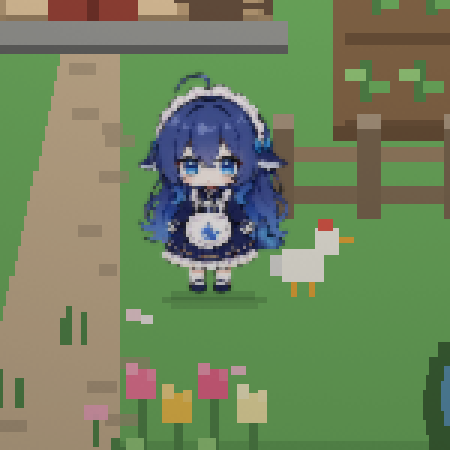

# 星鲸谷物语 · Starwhale Valley

一个住进手机里的像素农场：天色按真实时间流动，庄稼按季节换装，天气取自你头顶那片云。点一下地面，那只小鲸鱼就自己走过去。

  
  
  

## 安装

**一键导入**（链接永远指向最新 release，不用管版本号）：
<https://www.scripting.fun/import_scripts/?urls=%5B%22https%3A%2F%2Fgithub.com%2FMayntya%2Fstarwhale-valley-scripting%2Freleases%2Flatest%2Fdownload%2FStarwhale-Valley.scripting%22%5D>

手动：去 [最新 release](https://github.com/Mayntya/starwhale-valley-scripting/releases/latest) 下载 `Starwhale-Valley.scripting`，用 Scripting App 打开即可。

导入后有两个入口：

| 入口 | 怎么进 | 说明 |
|---|---|---|
| **全屏壁纸** | 脚本库 → 点「星鲸谷物语」 | 点右上角 `✕`，或连点画面三下退出 |
| **首页标签** | Scripting 首页 → 长按空位 → 选「星鲸谷物语」 | 常驻，切走自动暂停，没有退出键（退出会杀掉这个实例） |

想当真正的「壁纸」用就走第二个：它会一直活着，一整天自己变。

## 能干什么

| 模块 | 说明 |
|---|---|
| **天光** | 9 个时段关键帧平滑插值，日月按真实轨迹走，月亮有相位，夜里偶尔有流星 |
| **四季** | 春樱花 / 夏葵花 / 秋麦穗落叶 / 冬雪人积雪，草地、山、树、水面一起换色 |
| **天气** | 真实 WeatherKit 天气，32 种气象收敛成 6 类；拿不到就自己推算，**永不白屏**。雨丝、雪片、雾、闪电都有 |
| **农场** | 入夜亮窗、烟囱冒烟、池塘、橡树、稻草人、猫、鸡、小鸟、萤火虫 |
| **小鲸鱼** | 待机 / 左右跑 / 挥手，夜里自己提灯，脚下有一圈暖光 |
| **控制面板** | 时钟日期、天气温度、×1 / ×60 / ×600、暂停、两路音量、收起 |
| **声音** | 风 / 鸟 / 虫 / 雨 / 静夜五层自动混音 + 脚步与互动音效 + 一首循环小曲。**零音频素材，全是算出来的** |
| **不打扰** | 静止 6 秒面板自己收起；点右下角 `▤ 面板` 或随便点一下画面就能叫回来 |

## 怎么玩

- **点地面** —— 她走过去，落点自动避开池塘水面
- **走到东西旁边** —— 7 个互动点各有反应和台词：
  - **田** 按季节换词（嫩苗 / 野叶 / 穗子压手 / 短茬踩着脆）、**稻草人** 被戳得点两下头
  - **池塘** 荡开两圈涟漪，冬天是薄冰一碰就碎、**橡树** 春天落樱花、秋天黄叶、冬天掉雪
  - **农舍** 门锁着，只从窗缝透一点暖光、**季节摆件** 郁金香 / 向日葵 / 南瓜堆 / 歪鼻子雪人
  - **鸡** 绕着你转一圈，咕咕叫
- **面板按钮** —— `⏱` 倍速、`⏸` 暂停、`♪` 环境音三档、`♫` 曲子三档、`▤` 收起、`✕` 退出
- **点季节 / 天气标签** —— 循环切到某个季节或天气，方便预览少见天气
- **想看完一整天** —— 开 ×600，一天约 2 分半

## 声音

带耳机再开一遍，农场是会响的。风鸟虫雨静夜五层按时间 / 天气 / 季节连续加权混音，每道闪电配一声雷（画面和声音共用同一张节拍表，平均 9 秒一道），还有一首 38.4 秒无缝循环的星露谷风味小曲，夜里自动压低。走一步一声脚步，走到东西旁边有各自的动静。

声音走 `ambient` 会话：静音键一拨就静，也不会打断你在听的东西。

## 四季与天气

  
  
  
  

  
  
  

## 更多

- 版本历史与每版改了什么：[Releases](https://github.com/Mayntya/starwhale-valley-scripting/releases)
- 实现细节、调音参数、Roadmap、想自己改：见 [docs/TECH.md](docs/TECH.md)

## 致谢

- 小鲸鱼精灵图来自 [petdex.dev](https://petdex.dev/pets/deepseek)，**版权归原作者**，本仓库仅作个人学习展示，原作者如有异议会立即替换为自制素材
- 运行环境：[Scripting](https://www.scripting.fun) —— 在 iPhone 上写 SwiftUI / Canvas 的脚本 App
- 名字向《星露谷物语》致敬，纯属玩梗

## 许可

代码以 [MIT](./LICENSE) 授权。`docs/` 里的截图与角色精灵图版权归各自原作者，不在 MIT 范围内。
